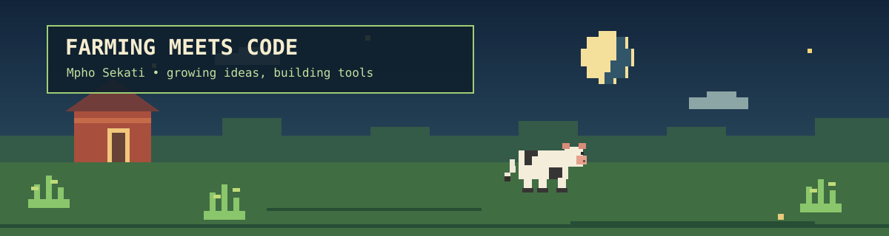

<!-- Mpho Sekati — a farmer experimenting with code -->

  

<h1 align="center">Hi, I'm Mpho 👋</h1>

<strong>Farmer at heart. Builder by curiosity. Always experimenting with code.</strong>

I didn't come to technology just to write code for code's sake. I keep coming back to the same question: **could a thoughtful tool make everyday work a little easier for farmers and the people around them?**

That question is where farming and software meet for me. I like trying ideas, learning by building, and seeing what happens when practical problems get a bit of imagination—and a few lines of code.

## 🌱 What I'm exploring

- **Tools for farming:** digital assistants, soil insights, and better ways to plan and make decisions.
- **AI with a purpose:** using it as a practical helper, not just a flashy demo.
- **Local food and commerce:** making it easier for people to connect with fresh produce and the people who grow and sell it.

## 🚜 Projects from the farm-to-code journey

- **[Abuti Spinach](https://github.com/mpho0sekati/Abuti-pinach)** — exploring practical digital tools for small-scale farming.
- **[Farmer Agent](https://github.com/mpho0sekati/Farmer-Agent)** — an AI-assisted farming project for research, planting calendars, and crop itineraries.
- **[Soil Analysis App](https://github.com/mpho0sekati/soil-analysis-app)** — experimenting with soil analysis and machine-learning-assisted crop insights.
- **[Mdeko](https://github.com/mpho0sekati/mdeko-momo-hackathon-2026)** — a fresh-produce marketplace concept connecting shoppers with nearby traders.
- **[BootLoops Blue](https://github.com/mpho0sekati/bootloops-blue)** — a different kind of fieldwork: high-precision tools for physics and quantitative science.

## 🧑🏽‍🌾 A little about how I build

I learn by making things. Some experiments grow into bigger ideas; others teach me what to try next. Either way, I want the work to stay grounded in real needs, useful to real people, and fun enough that I keep asking, “what if?”

**Things you'll find me exploring:** Python · TypeScript · AI · agriculture · product ideas · the occasional unexpected rabbit hole

## 🤝 Say hello

I'm always glad to connect with people who care about farming, useful technology, or building something from a curious little idea.

[Find me on GitHub](https://github.com/mpho0sekati)

<em>Plant an idea. Write some code. See what grows. 🌱</em>

